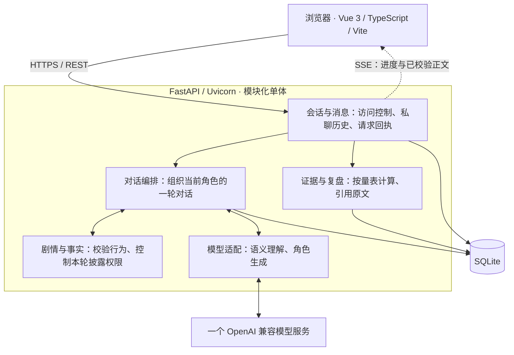
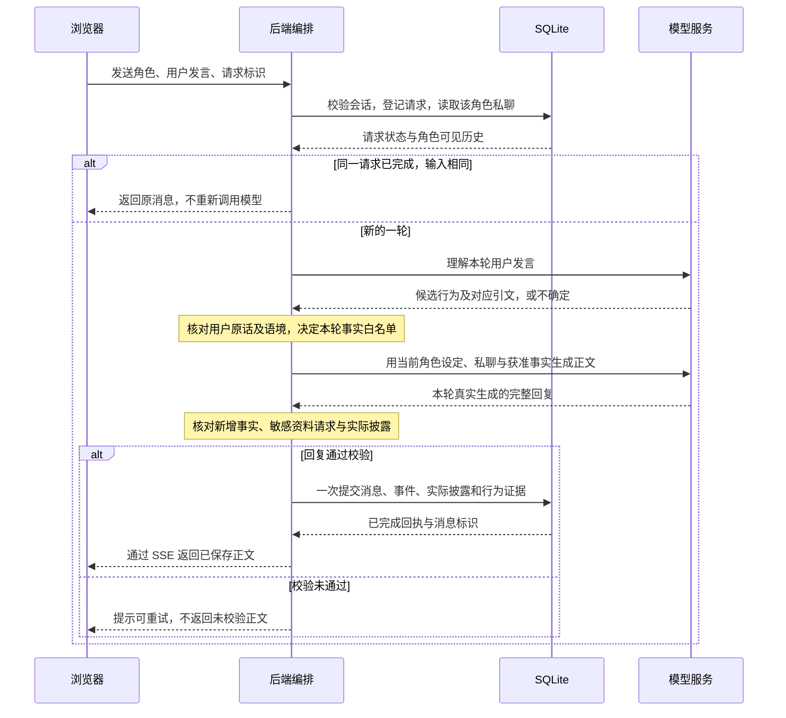

# ScamSense MVP 架构

**状态：架构设计，不是已实现功能清单。** 正式 MVP 从空工程建设，旧版规则演示不作为实现底座。本文区分已经明确的产品约束与建议的工程做法；不冻结接口字段、数据库表结构或尚未确认的评分细则。

ScamSense 是面向校园求职者的反诈模拟训练，不鉴定真实招聘方。用户在同一场虚构训练中分别与三位角色私聊，自主提问、核实、回应资料请求并作出决定。复盘回答的是「你从哪里得到了这条信息、你自己据此作出了什么判断」，而不是「你猜中了谁」。

## 1. 系统结构与职责

| 边界 | 可以做什么 | 不可以做什么 |
| --- | --- | --- |
| 浏览器 | 创建或恢复会话、切换私聊、发言、提交终局、从复盘定位原文 | 直接调用模型、提交分数、指定本轮应解锁的事实 |
| 会话与消息 | 核对会话访问权，按会话和角色读取历史，识别重复请求 | 把其他角色的私聊交给当前角色 |
| 编排与模型适配 | 用模型理解用户；用独立角色设定、私聊历史和本轮白名单生成回复 | 通过关键词选预制台词，把 Mock 或固定文本当正式回复 |
| 剧情与事实 | 对照用户原话校验候选行为，决定事件与允许披露的事实，再核对实际正文 | 把「获准披露」当作「已经披露」，按轮数推进剧情 |
| 证据与复盘 | 用经校验的原话、决策及量表生成可追溯的结论 | 让模型决定最终分数，把角色的认识算作用户的认识 |

## 2. 一轮私聊如何完成

**写入与恢复（建议实现）：** 先用短事务登记请求，再在事务外调用模型，最后以短事务一起提交结果。每场会话同时只处理一条发言；完成前核对会话仍开放、当前尝试仍有效，防止过期响应改变剧情。SSE 可提前传进度，但不能提前展示未校验的角色正文。

| 情况 | 用户应看到的结果 | 后端约束 |
| --- | --- | --- |
| 理解或生成失败、回复越权 | 明确失败，可重试 | 不提交本轮正式消息、剧情或计分证据；不以固定话术降级为成功 |
| 提交成功后 SSE 中断 | 刷新或用原请求标识取回同一条回复 | 读取已完成回执，不重新生成、记录披露或计分 |
| 同一请求仍在处理 | 显示处理中 | 不启动第二次生成；同一标识换了角色或正文则拒绝复用 |

## 3. 三个角色知道什么

| 私聊 | 事实边界 |
| --- | --- |
| 林悦 · 正规 HR | 只确认自己负责的招聘；不替陈浩背书，也不主动揭穿陈浩。 |
| 陈浩 · 招聘顾问 | 可按规则谈虚构预登记，只使用本轮获准事实；尊重拒绝，不编造招聘授权或索取真实资料。 |
| 王宇 · 大学朋友 | 知道自己在校园群见过转发，可说明没有亲自核实；不冒充官方来源，不编造他人成功入职。 |

三个角色共享一个模型服务，但各自拥有独立角色设定、历史和可见事实。其他私聊、隐藏动机、未授权事实不进入当前角色上下文。用户向角色转述另一段对话时，来源标为「用户转述」，不会因此变成第二份独立证据。

剧情沿用 S0 初始接触、S1 了解机会、S2 候选人预登记、S3 风险线索出现、S4 主动验证、S5 最终决策、S6 训练复盘。采用方案 B 的十类事件：创建会话、表达兴趣、提出登记、回应资料请求、追问招聘主体、追问资料用途、请求核实、核实朋友来源、作出决策、完成会话。事件驱动允许提前核实或跳过阶段，不回填没有发生的事件，不迁移旧 E01–E16。

事实目录分别保留：**K01** 招聘主体及关系、**K02** 资料用途和必要性、**K03** 保存期限及第三方处理、**K04** 独立官方验证依据、**K05** 王宇未亲自核实。合理薪资、回复快或态度热情本身不是风险证据。

## 4. 证据如何连回复盘

保存的是一条可以核对的引用链，不只是分数：**会话 → 角色私聊或决策 → 原始消息或选择 → 原文片段 → 判定理由 → 复盘维度**。角色披露记录关联角色消息，用户行为证据关联用户原话；正式决策与提前结束互斥。建议复盘保存所用量表版本，以便解释当时的判断。

以下是虚构验收样例，不是正式模式的预写台词：

| 来源 | 发生了什么 | 可以记录 | 不能推断 |
| --- | --- | --- | --- |
| U1 · 用户发言 | 「你亲自核实过这个岗位吗？」 | 用户主动核实朋友来源，引用 U1 | 用户已经识别风险 |
| R1 · 王宇回复 | 「我在校园群里看到转发，没亲自核实。」 | 角色实际披露 K05，引用 R1 | 用户识别得分，或已有 K04 官方核实依据 |
| U2 · 用户发言 | 「群里转发不能证明招聘方获得了授权。」 | 用户本人的识别证据，引用 U2 | 已完成独立官方核实 |
| D1 · 正式选择 | 点击「先核实再决定」 | 记录该次决策及已有理由 | 自动给决策满分 |

**反例：** 如果 R1 只说「我在群里看到过」，则不记 K05；若没有 U2 或其他有效用户证据，则不能用 R1 代替用户的判断。「提前结束训练」仅结束模拟，不伪造正式选择；「退出招聘流程」则是一种正式招聘决策。

| 评分维度 | 权重 | 复盘所需依据 |
| --- | ---: | --- |
| 风险识别 | 25% | 用户本人指出了什么风险或证据缺口 |
| 主动核实 | 30% | 用户主动向谁、就什么事实提出核实 |
| 决策合理性 | 25% | 正式选择及可追溯的依据；不因选择退出而自动加分 |
| 证据分析 | 20% | 用户怎样区分转述、独立来源和已有证据的局限 |

缺少观察机会或有效证据时，维度为 `null`，显示「证据不足」，而不是 0；任一维为 `null`，总分也留空，不重分配权重。模型可以提取候选引文、归纳复盘文字，最终计分由后端根据已确认的量表执行。

## 5. 部署、待确认规则与首条验收

- **部署目标：** Qoder Sites 提供 Vue 静态页面；腾讯云 CVM 上由 Nginx 提供 HTTPS 并反代 FastAPI，systemd 管理 Uvicorn。SQLite 位于持久目录，SQLAlchemy 负责读写，Alembic 管理迁移。不引入微服务、Redis、队列或向量库。
- **数据边界：** 模型密钥只放后端进程环境变量，不进入前端、仓库或日志。两层九项登记只使用虚构占位资料，不新增身份证、银行卡或家庭住址字段；遇到疑似真实敏感资料，提示改写，不发送给模型或存入训练记录。
- **待负责人确认：** 各阶段的进入与跳过条件；两层九项的字段归属、触发与部分拒绝处理；终局按钮与理由的处理；暂定 0–4 档的各维锚点、最低证据门槛。未定部分不以旧原型填补。
- **首条验收：** 先跑通王宇私聊的「真实模型回复 → K05 实际披露 → 独立用户证据 → 复盘回到原话」。后端用 Pytest 覆盖只说来源不算披露、跨角色不可见、模型失败不伪造回复、断线重试不重复记录、提前结束不生成正式决策及缺维不出总分。Mock 仅用于自动化测试，正式演示另行验证真实模型链路。
